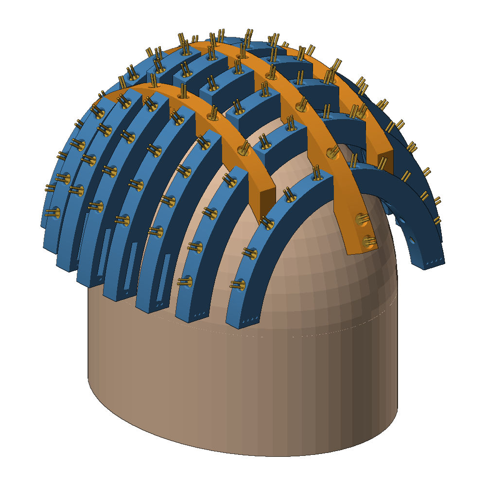

# DIY red-light (LLLT) laser helmet

A home-built low-level laser therapy helmet: **113 × 650 nm / 5 mW laser modules** held 12 mm above the scalp by a 3D-printed, flat-pack "egg-crate" frame. An Arduino timer has a head-switch interlock and current monitoring. All parts can be bought in India for roughly **₹9,000–10,000**.



> **Not a medical device, not medical advice.** See a dermatologist first. The lasers are Class 3R. Read the safety section of the guide before you buy anything, and test every laser module before you fit it.

## Start here

Open **[`index.html`](index.html)**, the full illustrated build guide. It covers safety, the evidence, the parts list with Indian shops, ten build steps, wiring, firmware, a dose calculator and a session log.

- On GitHub, you can view it rendered with [raw.githack](https://raw.githack.com/purvammm/Purvam-Portfolio/diy-laser-helmet/diy-laser-helmet/index.html). That link assumes the repo is public and the branch is `diy-laser-helmet`.
- To read it offline or on a phone, download **[`DIY-LLLT-Helmet-Guide.html`](DIY-LLLT-Helmet-Guide.html)**. It is a single file with all images built in.

## What is in this folder

| Path | Contents |
|---|---|
| `cad/lllt_helmet.scad` | Parametric OpenSCAD model of every part. Set `head_length`, `head_width`, `head_height` in the Customizer |
| `stl/` | Print-ready parts for the default head (190 × 150 × 100 mm) |
| `firmware/lllt_controller/` | Controller: hold-to-start, head interlock, presets 10/15/20/25 min, 30 min hard cap, watchdog, over/under-current and supply checks, EEPROM log |
| `firmware/diode_tester/` | Measures each module's current and approximate optical power (BPW34) and rejects outliers |
| `electronics/` | `schematic.svg` (controller) and `wiring.svg` (helmet harness) |
| `bom/bom_india.csv` | Parts list with Indian shops and approximate prices |
| `images/` | Renders and diagrams used by the guide |
| `tools/` | `export_all.sh` (all STLs), `make_images.py` and `render_stl.py` (renders), `make_svgs.py` (diagrams), `build_guide.py` (parts table and offline guide) |

## Parts to print (PETG, no supports, all fit a 180 × 180 mm bed)

| Part | Qty | | Part | Qty |
|---|---|---|---|---|
| `coronal_1` … `coronal_4` | 2 each | | `fit_test` (print first) | 2 |
| `sagittal_center` | 1 | | `standoff_peg` | 3–4 |
| `sagittal_side` | 2 | | `interlock_clip` | 1 |
| `controller_box` + `controller_lid` | 1 + 1 | | `tester_jig` | 1 |

## Key numbers (default build)

- 113 modules, about 1.6 cm apart, covering about 295 cm² of scalp (more than 4 cm above the ears).
- About 2.8 A at 5 V, which is about 14 W of heat. That is why the frame is open and printed in PETG.
- With modules that measure 4 mW: 452 mW total, 1.5 mW/cm² average, **20 min ≈ 540 J per session**. That falls inside the 450–650 J per session that Capillus 272, Theradome PRO and iRestore Professional deliver from their lasers.
- Suggested routine: 20 min every other day for at least 16 weeks.

## What was verified

- The model's `check_interference` part renders empty, so no two ribs collide. Every STL is a closed manifold mesh.
- Both sketches compile for Arduino Nano (ATmega328P, new and old bootloader).
- The controller's safety logic ran in a host-side simulation, and these behaviours worked: start refused without head contact, instant cut-off when the helmet is lifted, no automatic restart, session end, fault latching, shorted-MOSFET alarm, low-supply stop.
- Not verified: nothing has been built or printed yet. Print the `fit_test` coupon first, and follow the first power-up checklist in the guide.

## Regenerate after changing parameters

```bash
tools/export_all.sh -D head_length=200 -D head_width=158 -D head_height=105   # STLs
python3 tools/make_images.py -D head_length=200 -D head_width=158 -D head_height=105  # renders (needs numpy, trimesh, pillow, matplotlib)
python3 tools/build_guide.py   # parts table and offline guide
```
